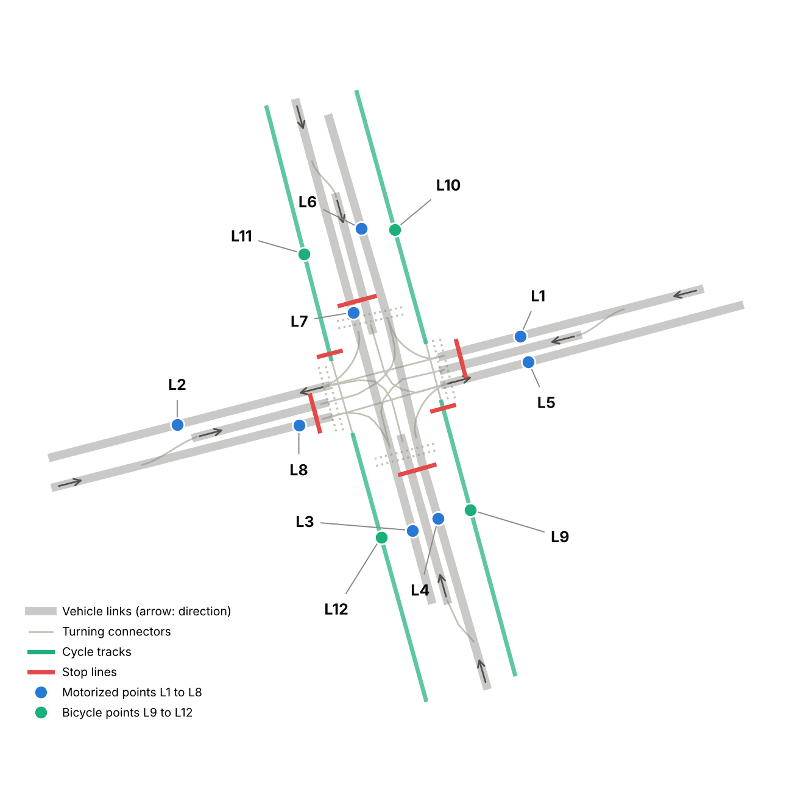
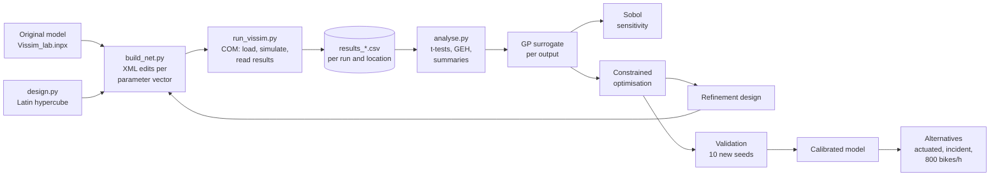
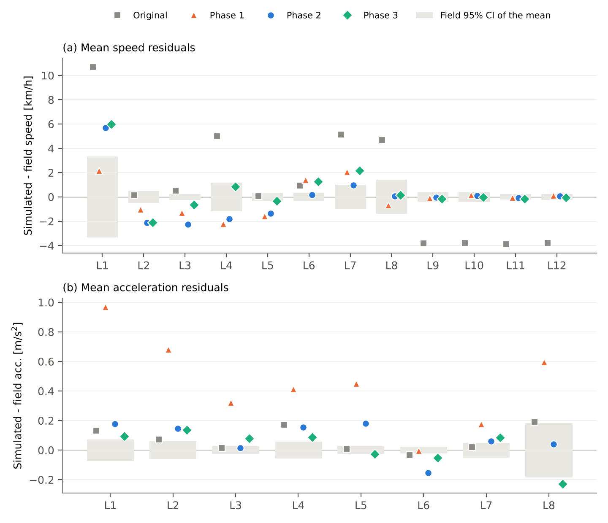
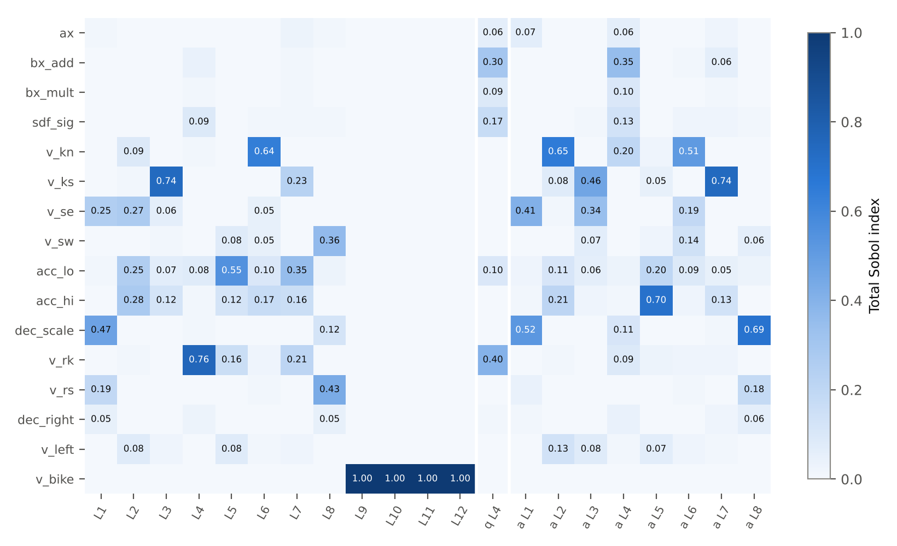
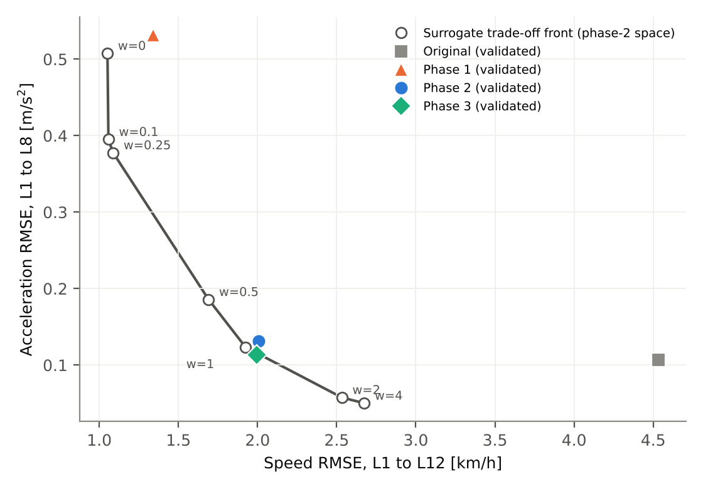
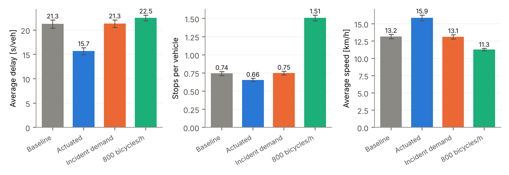
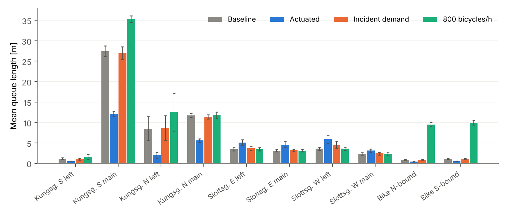
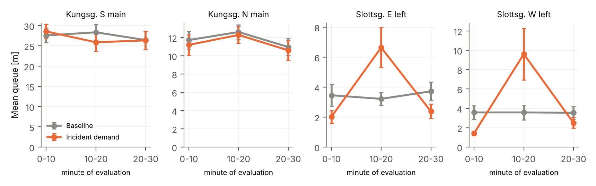

# Surrogate-Based Calibration of a Vissim Intersection Model

**Automated batch simulation of PTV Vissim from Python, Gaussian-process surrogates, global sensitivity analysis, constrained optimisation and scenario analysis**

Kungsgatan and Slottsgatan intersection, Norrköping (Sweden) · Infra Informatics PhD course, Simulation module (Linköping University) · October 2026

   

---

## Overview

This repository contains the complete, reproducible workflow used to calibrate a microscopic traffic simulation model of a signalised intersection against field measurements, and to evaluate three alternative designs with the calibrated model.

Instead of the manual one-parameter-at-a-time procedure, PTV Vissim is controlled programmatically through its COM interface. Hundreds of model variants are generated, simulated and evaluated without manual interaction. A machine-learning surrogate (one Gaussian process per measured quantity) replaces the simulator during optimisation and sensitivity analysis. Every candidate is finally validated in Vissim with independent random seeds and the statistical tests of the course.

| | |
|---|---|
| **Field data** | Mean speeds at 12 locations (8 motorised, 4 bicycle) and mean accelerations at 8 locations, 10 weekday mornings |
| **Simulation effort** | 1,937 Vissim runs (3 calibration phases + 4 design scenarios) |
| **Surrogate accuracy** | Cross-validated R² ≥ 0.97 for all 12 mean speeds |
| **Result** | Speed RMSE reduced from 4.53 to 2.01 km/h while keeping the acceleration profile (RMSE 0.13 m/s²); all bicycle locations pass the t-test; demand fully served (max GEH 0.68) |
| **Alternatives** | Actuated control reduces delay by 26 %; incident demand causes only temporary side-road queues; 800 bicycles/h reduce car capacity by 7 % |

The full write-up is in [`Report/Vissim_calibration_report.pdf`](Report/Vissim_calibration_report.pdf) (22 pages) and the seminar slides in [`Report/Vissim_slides.pdf`](Report/Vissim_slides.pdf).

---

## Table of contents

1. [The model](#the-model)
2. [Workflow](#workflow)
3. [Repository structure](#repository-structure)
4. [Technical setup](#technical-setup)
5. [How Python drives Vissim](#how-python-drives-vissim)
6. [Running the calibration](#running-the-calibration)
7. [Running the alternative designs](#running-the-alternative-designs)
8. [Methodology](#methodology)
9. [Results](#results)
10. [Troubleshooting](#troubleshooting)
11. [Reproducibility and data](#reproducibility-and-data)

---

## The model

One four-armed intersection with a fixed-time controller (stage-based program 1, cycle 90 s; about 48 s effective green for Kungsgatan and 38 s for Slottsgatan). Demand: 660 and 1040 veh/h on Kungsgatan, 240 and 210 veh/h on Slottsgatan, 100 bicycles/h per direction. The single northbound lane of Kungsgatan operates at a degree of saturation of about 0.95, which makes the model very sensitive to every parameter that affects the saturation flow.

<p align="center"></p>

L1 to L8 measure motorised traffic (approach points L1, L4, L8; queue discharge L7, which lies 2 m after the stop line; exit points L2, L3, L5, L6). L9 to L12 lie on the cycle tracks.

---

## Workflow



---

## Repository structure

```
.
├── II-sim Vissim lab (2025)/      Original course model and data (never modified by the scripts)
│   ├── Vissim_lab.inpx            Vissim network (PTV Vissim 2026)
│   ├── Fixed_time.sig             Fixed-time signal program (VISSIG)
│   ├── Control_logic.vap          Actuated control logic (VisVAP)
│   ├── Signal_data.pua            Stages and interstages for the VAP controller
│   ├── traffic_measurements.xlsx  Field data: speeds and accelerations, 10 mornings
│   └── *.pdf                      Lab instructions and Vissim installation guide
│
├── Calibration/                   Phase 1: calibration on speeds (15 parameters)
├── Calibration_phase2/            Phase 2: speeds + accelerations, direction-specific speeds (14 parameters)
├── Calibration_phase3/            Phase 3: t-test objective, acceleration-curve shape (16 parameters)
│   ├── common.py                  Paths, parameter space, field data loader, GEH
│   ├── build_net.py               Writes a model variant (.inpx) for a parameter vector
│   ├── design.py                  Latin hypercube screening and refinement designs
│   ├── run_vissim.py              Vissim COM runner (resumable batch simulation)
│   ├── analyse.py                 Statistics, GP surrogates, Sobol indices, optimisation, validation
│   ├── run_pipeline.py            One-command driver: smoke / screen / refine / validate / all
│   ├── design_*.csv               Simulated parameter combinations
│   ├── results_*.csv              Raw results: one row per configuration, replication, location
│   ├── summary_*.csv              Per-configuration statistics
│   ├── report_training.txt        Surrogate quality, sensitivity, optimum
│   ├── report_validation.{txt,tex} Validation with independent seeds (LaTeX tables included)
│   └── sensitivity_heatmap.png    Total Sobol indices
│
├── Alternatives/                  Design scenarios with the calibrated model
│   ├── scenarios.py               BASE, ACTUATED, INCIDENT, BIKE800
│   ├── run_alt.py                 Runner: network performance, queues, speeds
│   ├── analyse_alt.py             Paired comparison, tables, figures
│   ├── run_alternatives.py        Driver: smoke / all
│   └── alt_*.csv, alt_report.txt  Results
│
└── Report/
    ├── Vissim_calibration_report.{tex,pdf}   Full report (22 pages)
    ├── Vissim_slides.{tex,pdf}               Seminar slides (beamer)
    └── fig_*.png                             Figures used in the report and this README
```

The folder name `II-sim Vissim lab (2025)` is kept exactly as in the course material because all scripts locate the model relative to their own folder (`common.py`).

---

## Technical setup

### Requirements

| Component | Version used | Notes |
|---|---|---|
| Windows | 10/11 (university VM) | Vissim and COM are Windows-only |
| PTV Vissim | 2026 (SP 07), Thesis licence | Must be installed and licensed; COM server is registered by the installer |
| Python | 3.14 (64-bit) | Same bitness as Vissim |
| Python packages | see `requirements.txt` | `pywin32` provides the COM bridge |

The analysis scripts (`analyse.py`, `analyse_alt.py`, `design.py`, `build_net.py`) are pure Python and run on any OS. Only `run_vissim.py` and `run_alt.py` need Windows with Vissim.

### Installation

```powershell
git clone https://github.com/nomantabassum38/vissim-surrogate-calibration.git
cd vissim-surrogate-calibration
py -m pip install -r requirements.txt
```

### Check the COM connection

```powershell
py -c "import win32com.client as c; v=c.Dispatch('Vissim.Vissim'); print(v.AttValue('Version'))"
```

This should print e.g. `PTV Vissim Thesis 2026 (SP 07)`. Close any open Vissim window first: `Dispatch` starts its own instance, and a thesis licence may allow only one.

---

## How Python drives Vissim

### 1. Model variants are written as XML

A Vissim `.inpx` file is XML. `build_net.py` parses the original network with `xml.etree.ElementTree` and edits only the attributes that belong to the parameter vector, for example:

| Parameter | XML object edited |
|---|---|
| Car following (W74 `ax`, `bxAdd`, `bxMult`, reduction near stop lines) | `drivingBehavior no="1"` |
| Desired speed per approach | new `desSpeedDistribution` (uniform), assigned through `vehicleComposition` to each `vehicleInput` |
| Acceleration / deceleration behaviour | `y`, `yMin`, `yMax` of `desAccelerationFunction` / `desDecelerationFunction` 1 and 2 (optionally speed-dependent scaling) |
| Turning speeds | `vehClassSpeedReduction` of the reduced-speed areas on the turning connectors |
| Bicycle speeds | distributions of composition 3 |
| Evaluation | `simPeriod` 2400 s, data collection 600 to 2400 s (warm-up) |

Every variant is also marked as a stand-alone network (`netPara underScenMngm="false"`), see [Troubleshooting](#troubleshooting).

### 2. Simulation through COM

```python
import win32com.client as com
vissim = com.Dispatch("Vissim.Vissim")
vissim.LoadNet(r"C:\Temp\vissim_calibration_phase2\LHS_001\Vissim_lab.inpx", False)

sim = vissim.Simulation
sim.SetAttValue("NumRuns", 3)
sim.SetAttValue("RandSeed", 42)
sim.SetAttValue("RandSeedIncr", 1)
sim.SetAttValue("UseMaxSimSpeed", True)
vissim.Graphics.CurrentNetworkWindow.SetAttValue("QuickMode", 1)
vissim.SuspendUpdateGUI()
sim.RunContinuous()
vissim.ResumeUpdateGUI()

for dcm in vissim.Net.DataCollectionMeasurements.GetAll():
    speed = dcm.AttValue("SpeedAvgArith(1,1,All)")   # (simulation run, time interval, vehicle class)
    acc   = dcm.AttValue("Acceleration(1,1,All)")
    vehs  = dcm.AttValue("Vehs(1,1,All)")
```

The runner stages every variant in its own folder under `C:/Temp`, deletes old simulation runs before simulating (so stale replications are never read), parses the Vissim `.err` files for vehicle inputs that could not be completed, appends the results to a CSV and removes the staging folder. Interrupted batches resume automatically: configurations already in the results file are skipped. One configuration with three replications of 40 minutes takes about 21 s in quick mode.

### 3. The actuated controller through COM

```python
sc = vissim.Net.SignalControllers.ItemByKey(1)
sc.SetAttValue("Type", "VAP")
sc.SetAttValue("SupplyFile1", r"...\Control_logic.vap")
sc.SetAttValue("SupplyFile2", r"...\Signal_data.pua")
```

### 4. Network performance and queues

```python
vnp = vissim.Net.VehicleNetworkPerformanceMeasurement
delay = vnp.AttValue("DelayAvg(1,1,All)")
for q in vissim.Net.QueueCounters.GetAll():
    qlen = q.AttValue("QLen(1,1)")       # (simulation run, time interval)
```

---

## Running the calibration

Each phase folder is self-contained. From a PowerShell in the phase folder on the Vissim computer:

```powershell
cd Calibration_phase2
py run_pipeline.py smoke      # 2 configurations x 1 run: checks COM, attribute names and timing (~1 min)
py run_pipeline.py all        # screening -> surrogate -> refinement -> validation (~1.5 h)
```

Individual stages:

```powershell
py design.py screen                                    # 160-point Latin hypercube
py run_vissim.py --design design_screen.csv --runs 3 --out results_screen.csv
py analyse.py train                                    # surrogates, Sobol indices, optimum, validation design
py design.py refine                                    # 40 points around the optimum
py run_vissim.py --design design_refine.csv --runs 3 --out results_refine.csv
py analyse.py train
py run_vissim.py --design design_validate.csv --runs 10 --seed 1001 --incr 7 --out results_validate.csv
py analyse.py validate                                 # t-tests, GEH, replications, odd/even days, LaTeX tables
```

Progress is written to `pipeline_log.txt` (with an ETA per configuration) and `pipeline_status.txt`. The analysis step can be repeated on any computer from the CSV files.

---

## Running the alternative designs

```powershell
cd Alternatives
py run_alternatives.py smoke  # each scenario once (~1 min)
py run_alternatives.py all    # 4 scenarios x 20 replications + analysis (~10 min)
```

| Scenario | Modification of the calibrated baseline |
|---|---|
| `BASE` | Fixed-time program 1, constant demand |
| `ACTUATED` | Controller type VAP with `Control_logic.vap` and `Signal_data.pua` |
| `INCIDENT` | Inputs A, C, E, G vary every 10 minutes (Table 1 of the lab) |
| `BIKE800` | 800 bicycles/h per direction |

All scenarios use the same random seeds (common random numbers), so differences are tested with paired t-tests.

---

## Methodology

**Statistical comparison.** For each location the course two-sample t-test with pooled variance is applied (10 field days vs. n simulation runs, α = 0.05). The required number of replications follows n = (t·s / (ε·x̄))² with ε = 0.05.

**Realism constraints.** Every candidate must serve the demand: GEH ≤ 5 at L1 to L8, and the flow at the near-saturated approach L4 must reach at least 97 % of the original model. Without this constraint the optimiser prefers configurations in which up to 30 % of the demand cannot enter the network, because the congestion lowers the approach speed.

**Surrogate.** One Gaussian process per output (12 speeds, 8 flows, 8 accelerations): Matérn 5/2 kernel with automatic relevance determination plus a white-noise term, inputs scaled to [0, 1], hyper-parameters by maximum marginal likelihood, 5-fold cross-validation.

**Sensitivity.** Saltelli sampling with Jansen estimators of first-order and total Sobol indices on the GP mean (2,048 base samples).

**Optimisation.** 2¹⁵ Sobol points on the surrogate, followed by five rounds of local search around the 32 best points; three distinct optima plus the best simulated configuration and the original model are validated in Vissim with ten independent replications.

**Three phases.**

| Phase | Objective | Key change | Outcome |
|---|---|---|---|
| 1 | Speed RMSE | 15 parameters incl. turning speeds and conflict areas | Best speed fit, but unrealistic braking destroys the accelerations |
| 2 | Speed and acceleration RMSE, each normalised by the field day-to-day s.d. | Desired speed per approach | **Recommended model**: best overall balance, most t-tests passed |
| 3 | Hinge loss on standardised errors (maximises passed t-tests) | Acceleration-curve shape, split right-turn speeds, reuse of 404 earlier runs | Confirms that the remaining misfits are structural |

---

## Results

### Calibration

| Validation (10 independent replications) | Original | Phase 1 | **Phase 2** | Phase 3 |
|---|---|---|---|---|
| Speed RMSE, L1 to L12 [km/h] | 4.53 | 1.34 | **2.01** | 2.00 |
| Acceleration RMSE [m/s²] | 0.107 | 0.531 | **0.131** | 0.114 |
| Speed t-tests passed | 2/12 | 6/12 | **7/12** | 7/12 |
| Acceleration t-tests passed | 7/8 | 1/8 | **3/8** | 2/8 |
| Max GEH | 0.68 | 0.68 | **0.68** | 0.69 |
| Speed RMSE odd / even field days | 4.48 / 4.63 | 1.28 / 1.55 | **1.83 / 2.27** | 1.95 / 2.14 |

<p align="center"></p>

*Simulated minus field mean for the four models; grey bars are the 95 % confidence intervals of the field mean.*

<p align="center"></p>

*Total Sobol indices of the 16 phase-3 parameters for speeds, served flow and accelerations (GP surrogate trained on 567 configurations).*

<p align="center"></p>

*Trade-off between speed and acceleration fit on the surrogate, with the validated models.*

**Calibrated parameters (phase 2).** Right-turn speed 10 km/h (originally 22.5), bicycle desired speed 17.3 km/h (13.5), Slottsgatan east 44 km/h (53), slightly tighter car following (bx_add 0.82, bx_mult 1.39), desired acceleration ×1.04, desired deceleration ×0.89.

### Alternative designs (20 paired replications)

| Scenario | Average delay [s/veh] | Δ vs. baseline | Stops/veh | Main effect |
|---|---|---|---|---|
| Baseline | 21.3 ± 0.8 | | 0.74 | |
| Actuated control | 15.7 ± 0.7 | −5.6 (−26 %, p < 0.001) | 0.66 | Kungsgatan northbound queue 27.5 → 12.1 m |
| Incident demand | 21.3 ± 0.8 | +0.1 (p = 0.67) | 0.75 | Slottsgatan left-turn queues ×2 to ×3 in minutes 10 to 20 |
| 800 bicycles/h | 22.5 ± 0.6 | +1.2 (p < 0.001) | 1.51 | Car flow at L4 −7 %, bicycle speed 17.9 → 16.5 km/h |

<p align="center"></p>

<p align="center"></p>

<p align="center"></p>

---

## Troubleshooting

| Symptom | Cause and fix |
|---|---|
| `The network file could not be loaded` for a copy of the model | The course network may belong to a Vissim scenario-management project (`underScenMngm="true"`, `.vissimpdb` next to it); such a file only loads beside its project database. `build_net.py` writes every variant as a stand-alone network. |
| `The simulation cannot be started in scenario management modes other than "Edit Scenario"` | Same cause; solved by the stand-alone flag. |
| COM `AttributeError` on a result attribute | Attribute names differ between Vissim versions; run `py run_pipeline.py smoke` first. Result attributes take sub-attributes `(simulation run, time interval, vehicle class)`. |
| Many "vehicle input could not be finished" warnings | Queue spill-back to the network entry (capacity too low); these configurations are excluded by the GEH and served-demand constraints. |
| Per-class network results are empty | The vehicle classes for result collection must be enabled in Evaluation > Configuration; the alternatives therefore use all-vehicle measures plus bicycle speeds and queues. |
| Vissim instance cannot start | Close the Vissim GUI before running; the licence may allow only one instance. |

---

## Reproducibility and data

* All raw results are included: one row per configuration, replication and measurement location (`results_*.csv`), with the exact parameter values in `design_*.csv`.
* Calibration: seed 42, increment 1 (common random numbers); validation: seed 1001, increment 7; alternatives: seed 42, increment 1, 20 replications.
* Simulation effort: phase 1 659 runs, phase 2 659, phase 3 539, alternatives 80; total 1,937 runs of 2,400 s simulated time.
* The course model, the lab instructions and the field data are course material of Linköping University and are included for reproducibility only.

## Author

**Muhammad Noman Tabassum**, applied mathematician. Developed for the Infra Informatics PhD course, Simulation module, Linköping University, 2026.
